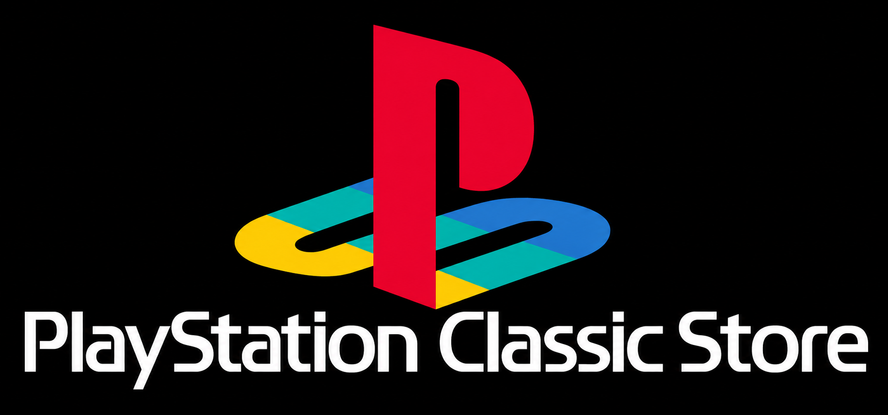

# PS Classic Store



PS Classic Store is a catalog browser and downloader for the PlayStation Classic running AutoBleem 2. Browse your own PS1 game, ROM, and app catalogs from one controller-friendly app.

## Download

[Download PS Classic Store 0.1.57 for USB](https://github.com/ZoneJ561/PS-Classic-Store/releases/download/v0.1.57/PS-Classic-Store-USB-0.1.57.zip)

There is **one ZIP**. Its `Apps/` folder is ready to drag onto the root of an AutoBleem USB drive. The ZIP includes the app and required third-party notices and source; it does not contain games, populated download catalogs, account cookies, kernel files, or Wi-Fi changes. An artwork lookup lets the app fetch ROM covers on demand.

## Built-in App Updates

Open **About** and press **Triangle** to check for a newer app version. If one is available, press Triangle again to download and install it. Close and reopen the Store to start the new version. The download is checked against the published size and SHA-256 before a separate USB version folder is activated. Your current version stays available if an update fails.

## Features

- Browse separate **NPS PSX**, **PSX Games**, **ROMs**, **Apps**, **Installed**, **Sources**, and **Packages** sections.
- Search listings, filter regions and ROM systems, and view game details and cover art. ROM browsing has cached system lookups and faster redraws; PSX Games has no fixed 10,000-entry cutoff. ROMs use 3D box, cabinet, cartridge, or front-cover art from the [LaunchBox Games Database](https://gamesdb.launchbox-app.com/) when available. NPS and PSX games can display region-matched 3D CD box art supplied in the catalog; other covers remain available as a fallback. Older emulator entries appear under Apps.
- Download PS1 disc archives, catalog ROMs, and apps from user-supplied HTTPS TSV feeds.
- Queue downloads, follow progress, and cancel an active job.
- Show only ROM systems with games in a local or refreshed catalog; empty TSV templates stay hidden. Unpack ZIP, 7z, and RAR ROM archives with visible install progress, and delete installed ROMs from the Installed tab with confirmation. The public build has no screenshot control.
- Convert supported PS1 packages to BIN/CUE files for AutoBleem.
- Support up to 32 catalog feeds. Catalog URLs refresh when the app opens.
- Stage and verify downloads before installing them. Existing game and app folders are protected from silent replacement.

## Getting Started

1. Shut down the PlayStation Classic and back up its AutoBleem USB drive.
2. For a first install or an upgrade from 0.1.43 or earlier, remove only the old `Apps/PS Classic Store` folder if present. Keep `System/PS Classic Store` so your catalogs, covers, downloads, and private settings remain.
3. Extract the release ZIP to the **USB root**, merging its `Apps/` folder.
4. Safely eject the drive, boot AutoBleem, and open **PS Classic Store** from Apps.

Users with the updater can move to 0.1.57 directly from **About**, without copying the ZIP from a PC. The installed version appears on the About page.

## Add Catalogs

Use [PS Classic Store Catalog Creator](https://github.com/ZoneJ561/PS-Classic-Store-Catalog-Creator) to create the TSV catalogs that PS Classic Store reads. The Store does not ship with populated game or app lists; you must make and add your own catalogs.

The ZIP includes blank catalog templates with column headers only. **No downloadable game entries are preloaded.** Every shipped TSV is a header-only catalog template. Artwork matching data is stored separately in `.idx` files and contains no game download catalog. Add your own TSV files under `System/PS Classic Store/sources/` on the USB. The app copies missing templates there on first launch; edit the copies under `sources/`, not the originals under `Apps/`. Keep the TSV header and use the matching `System` value in each row.

| TSV template | Store category / system |
| --- | --- |
| `super-nintendo-roms.tsv` | Super Nintendo |
| `sega-genesis-mega-drive-roms.tsv` | Sega Genesis / Mega Drive |
| `sega-cd-roms.tsv` | Sega CD |
| `nes-roms.tsv` | NES |
| `game-boy-roms.tsv` | Game Boy |
| `game-boy-color-roms.tsv` | Game Boy Color |
| `game-boy-advance-roms.tsv` | Game Boy Advance |
| `sega-master-system-roms.tsv` | Sega Master System |
| `game-gear-roms.tsv` | Game Gear |
| `sega-32x-roms.tsv` | Sega 32X |
| `turbografx-16-pc-engine-roms.tsv` | TurboGrafx-16 / PC Engine |
| `turbografx-cd-pc-engine-cd-roms.tsv` | TurboGrafx-CD / PC Engine CD |
| `bandai-wonderswan-roms.tsv` | Bandai WonderSwan / WonderSwan Color |
| `neo-geo-pocket-roms.tsv` | Neo Geo Pocket / Pocket Color |
| `atari-lynx-roms.tsv` | Atari Lynx |
| `arcade-roms.tsv` | General arcade |
| `capcom-play-system-1-roms.tsv` | Capcom Play System 1 |
| `capcom-play-system-2-roms.tsv` | Capcom Play System 2 |
| `capcom-play-system-3-roms.tsv` | Capcom Play System 3 |
| `snk-neo-geo-mvs-roms.tsv` | SNK Neo Geo MVS |
| `konami-roms.tsv` | Konami arcade |
| `midway-williams-roms.tsv` | Midway/Williams arcade |
| `sega-arcade-hardware-roms.tsv` | Sega arcade hardware |
| `namco-roms.tsv` | Namco arcade |
| `data-east-roms.tsv` | Data East arcade |
| `taito-roms.tsv` | Taito arcade |

WonderSwan and Neo Geo Pocket catalogs should specify the exact variant in each row's `System` column so the game installs to the right RetroArch folder. CD games require a compatible core and BIOS.

Arcade categories all install into `RetroArch/roms/Arcade/`. Arcade ZIPs must contain a complete ROM set compatible with the selected RetroArch core. A clone-only ZIP may need its matching parent set; a non-merged set includes the required files in one ZIP.

To have the Classic fetch hosted TSV updates automatically, put a `.txt` file in `System/PS Classic Store/sources.d/` (or use `System/PS Classic Store/sources.txt`). Each line is a display name, a **tab character**, and a direct HTTPS link to a TSV file, for example:

```text
My NES catalog	https://example.org/nes-roms.tsv
My arcade catalog	https://example.org/arcade-roms.tsv
```

The store reads up to 32 feeds and refreshes them when it opens. Catalogs, covers, downloads, and private settings under `System/PS Classic Store/` are kept when the app updates. Use links and content you are authorized to access.

## Authorized Use

**I do not condone piracy in any way.** Create catalogs and use the Store only for games and apps you have permission to access, download, and use. You are responsible for the content and links you add.

## Archive.org account cookies

Public Archive.org files need no account cookie. If your Archive.org account is allowed to download a restricted item:

1. Sign in to `archive.org` in a browser on your trusted Windows PC.
2. Export **only the Archive.org cookies** to a Netscape `cookies.txt` format file using a tool you trust. A browser's JSON cookie export is not the format this app reads.
3. Rename the file `archive-cookies.txt` and copy it to the AutoBleem USB at `System/PS Classic Store/private/archive-cookies.txt`. Create the `private` folder if it is not present.
4. Safely eject the USB and reopen PS Classic Store. The app sends this cookie file only when downloading from Archive.org. An expired cookie or an item your account cannot access can still fail.

The cookie file contains an account session token in plain text. Keep it off public catalogs, releases, screenshots, and shared ZIPs. Remove it from the USB when you no longer need it. The app does not need your Archive.org password.

## Project Updates and Support

- Follow the creator on Instagram: [@god1ynigga](https://www.instagram.com/god1ynigga/)
- Support development: [Venmo](https://venmo.com/u/godlynigga)
